# CLAUDE.md

Claude Code (claude.ai/code) reads this repository guidance.

## What this repo is

A distribution package for a single Hermes Agent skill (`revenium`) that adds Revenium guardrails-based budget enforcement and usage metering to Hermes. There is no build step, compiled artifact or application runtime here. Hermes consumes the repo as a GitHub tap, an `external_dirs` entry or a copy into `~/.hermes/skills/`.

The skill itself lives at `skills/revenium/` and is the only thing end users install. Everything else (`docs/`, `tests/`, `install.sh`, `assistant-skill/`, `README.md`) is packaging metadata. Check `tests/test_repository.py::test_expected_files_exist` before assuming a file is or isn't part of the skill.

## Common commands

```bash
# Run the smoke tests (stdlib unittest only)
python3 -m unittest discover -s tests -p 'test_*.py' -v

# Single test class / method
python3 -m unittest tests.test_repository.RepositoryTests
python3 -m unittest tests.test_repository.RepositoryTests.test_runtime_paths_are_hermes_native

# Install from a clone: copies skills/revenium/ into ~/.hermes/skills/revenium/,
# then hands off to the bundled installer (credentials, plugin, hooks, rules, cron, restart)
bash install.sh

# Same thing when the skill is already on the host
bash ~/.hermes/skills/revenium/scripts/install.sh

# Drive the runtime pieces manually after install
bash ~/.hermes/skills/revenium/scripts/cron.sh              # one tick: all seven stages
bash ~/.hermes/skills/revenium/scripts/hermes-report.sh     # completion metering only
bash ~/.hermes/skills/revenium/scripts/guardrail-check.sh   # guardrail evaluation only
bash ~/.hermes/skills/revenium/scripts/tool-event-report.sh # tool-event metering only
bash ~/.hermes/skills/revenium/scripts/api-event-report.sh  # api-event metering only
bash ~/.hermes/skills/revenium/scripts/drain-status.sh      # spool drain health (alert-only)
bash ~/.hermes/skills/revenium/scripts/costs-status.sh      # which classified job types have no configured costs (read-only)
bash ~/.hermes/skills/revenium/scripts/clear-halt.sh        # clear all halts (--rule-id <id> for one)
bash ~/.hermes/skills/revenium/scripts/prune-markers.sh --dry-run   # marker + assessment GC (manual, never in cron)
bash ~/.hermes/skills/revenium/scripts/correct-assessment.sh --job-id <id> --value <n> \
  --currency USD --reason <text> [--dry-run]   # append a correction (operator-only, never in cron)

# Per-concern install / diagnostics
bash ~/.hermes/skills/revenium/scripts/install-plugin.sh    # classifier plugin into the profile's plugins/
bash ~/.hermes/skills/revenium/scripts/install-hooks.sh     # register the three shell hooks in config.yaml
bash ~/.hermes/skills/revenium/scripts/setup-guardrails.sh --interactive  # create the budget rules
bash ~/.hermes/skills/revenium/scripts/install-cron.sh      # per-minute crontab line
bash ~/.hermes/skills/revenium/scripts/diagnose.sh          # read-only end-to-end metering triage (--tick, --profile)
bash ~/.hermes/skills/revenium/scripts/plugin-status.sh     # is the classifier registered and current?
bash ~/.hermes/skills/revenium/scripts/hooks-status.sh      # are the hooks registered and live?
bash ~/.hermes/skills/revenium/scripts/uninstall-hooks.sh
bash ~/.hermes/skills/revenium/scripts/uninstall-cron.sh
```

The repo has no linter or formatter. Bash scripts use `set -uo pipefail` (or `-euo pipefail` for the simpler ones); preserve that when editing.

## Architecture

The skill has three parts. They communicate only through files under `~/.hermes/state/revenium/`.

1. **In-session (inside the Hermes process).** The `revenium-classifier` plugin classifies what a session was *doing* and writes marker files; three shell hooks enforce guardrails and capture tool calls; `SKILL.md` is a procedural backstop for the halt check. None of these makes a network call to Revenium.

2. **State files (`~/.hermes/state/revenium/`).** The public interface consists of `config.json`, `guardrail-status.json`, `plugin-status.json`, `markers/`, `tool-events/`, the ledgers, the taxonomies and the log. Every process re-reads what it needs; there is no shared memory and no IPC.

3. **The cron pipeline (every minute, out of process).** `cron.sh` takes `cron.lock`, then runs seven stages: plugin health → completion metering → guardrail evaluation → tool-event metering → api-event metering → outcome metrics → drain status. (A conditional legacy `alertId` migration runs first when one is present; it is not one of the seven.) Only this pipeline calls the Revenium API or talks back to Hermes (via one `hermes chat` call on a new halt). The completion-metering stage also runs a post-loop auxiliary-usage pass inside `hermes-report.sh`. That pass is not one of the seven stages.

```mermaid
flowchart TB
    subgraph HS["Hermes session (in-process)"]
        SKILL["SKILL.md<br/>halt-check backstop"]
        PLC["pre_llm_call.sh<br/>halt directive + warn band"]
        PTC["pre_tool_call.sh<br/>block tool calls when halted"]
        POSTTC["post_tool_call.sh<br/>pure observer"]
        PLUG["revenium-classifier plugin<br/>on_session_end / on_session_finalize<br/>post_llm_call / post_api_request"]
        AUX["aux LLM<br/>agent.auxiliary_client.call_llm"]
        PLUG -->|"transcript to task_type + job"| AUX
    end

    subgraph ST["~/.hermes/state/revenium/ — the only coupling"]
        CFG["config.json"]
        GST["guardrail-status.json"]
        PST["plugin-status.json"]
        MK["markers/&lt;sid&gt;.jsonl<br/>GUARDRAIL + CHAT pairs"]
        RDY["markers/.ready/&lt;sid&gt;<br/>settle sentinel"]
        WARN["markers/.warn, .fallback-warn, .aux-warn<br/>once-per-(session, rule) flags"]
        TEV["tool-events/&lt;sid&gt;.jsonl"]
        LED["revenium-hermes.ledger"]
        JLED["revenium-jobs.ledger"]
        TLED["revenium-tool-events.ledger"]
        ALED["revenium-aux.ledger"]
        TAX["task-taxonomy.json<br/>job-taxonomy.json<br/>role-taxonomy.json"]
        LOG["revenium-metering.log<br/>in-place rotation"]
        LOCKS["cron.lock, rules.lock, prune.lock, tool-events.lock"]
    end

    subgraph CRON["cron pipeline (per minute, out of process)"]
        CS["cron.sh<br/>flock cron.lock, optional sub-minute loop"]
        MIG["setup-guardrails.sh --from-alert --auto<br/>legacy alertId to ruleIds"]
        PS["plugin-status.sh<br/>alert-only plugin health"]
        HR["hermes-report.sh<br/>delta split + meter<br/>+ auxiliary usage post-loop pass"]
        GC["guardrail-check.sh<br/>rule state + halt transition"]
        TER["tool-event-report.sh"]
        SPLIT["split_strategies<br/>pair collapse, equal_split (conservation invariant),<br/>trace name, parent transaction id"]
        CS --> MIG & PS & HR & GC & TER
        HR -.->|imports| SPLIT
    end

    subgraph EXT["external"]
        DB[("~/.hermes/state.db<br/>read-only")]
        RCLI["revenium CLI to Revenium API"]
        MSG["hermes chat --toolsets messaging"]
    end

    subgraph OPS["operator entry points"]
        INS["install.sh<br/>creds, plugin, hooks, rules, cron, restart"]
        CH["clear-halt.sh<br/>sole clearer of halted"]
        PM["prune-markers.sh<br/>manual, not in cron"]
        HSTAT["hooks-status.sh / plugin-status.sh"]
    end

    PLUG -->|reads transcript| DB
    PLUG --> MK & RDY
    PLUG --> TAX
    PLUG -->|"skip while halted"| GST
    POSTTC --> TEV
    PLC --> GST
    PTC --> GST
    PTC -->|"CANCELLED job marker"| MK
    PLC --> WARN
    SKILL -.->|fail-open read| GST

    HR --> DB
    HR --> MK & RDY & LED & JLED & PST & CFG & ALED
    HR -->|"jobs create/outcome + meter completion<br/>--task-type --trace-type --trace-name --parent-transaction-id<br/>--agentic-job-id --squad-name"| RCLI
    HR -->|"auxiliary pass: meter completion --operation-type AUX --task-type aux_*"| RCLI
    GC --> CFG
    GC -->|"enforcement-rules get + budget-rules list"| RCLI
    GC --> GST
    GC -->|"on NEW halt: embed enforcement-event"| MSG
    TER --> TEV & TLED
    TER -->|"reads root markers, jobs ledger, plugin status"| MK & JLED & PST
    TER -->|"read-only ancestry + root liveness"| DB
    TER -->|"meter tool-event --trace-id root --workflow-id owning job"| RCLI
    PS --> PST
    CH --> GST
    PM --> MK
    INS --> CS
```



### State separation

Mutable state lives under `~/.hermes/state/revenium/`. Skill content lives under `~/.hermes/skills/revenium/`. Do not write runtime state into the skill directory. `tests/test_repository.py::test_runtime_paths_are_hermes_native` enforces that `common.sh` continues to use `.hermes` and `state/revenium` and asserts the presence of every state path variable listed below.

`scripts/common.sh` is the single source of truth for state paths. Add new paths there, between the existing declarations and the `mkdir -p`, never inline in a calling script. It also owns `ensure_path`, the `log`/`info`/`warn`/`error` helpers, `rotate_log_if_needed`, the CLI capability probes (`has_guardrails_cli`, `supports_flag`), the session-identity helpers (`get_root_session_id`, `resolve_markers_dir`, `resolve_team_id`) and the fleet helpers (`hermes_profile_homes`, `default_agent_name_for_profile`).

Two dimensions have separate defaults in `common.sh`: `REVENIUM_AGENT_NAME` (the AGENT dimension, `Hermes` or `Hermes-<profile>`) and `REVENIUM_SQUAD_NAME` (the SQUAD dimension, which spans agents and requires an empty default for backward compatibility). `organizationName` is neither; `warn_if_org_looks_like_agent` exists because operators kept conflating them.

### Classification pipeline (markers)

The `revenium-classifier` plugin (`skills/revenium/plugins/revenium-classifier/`) registers four Hermes hooks: `on_session_end`, `on_session_finalize`, `post_llm_call` and `post_api_request` (added in Phase 32 for the per-API-call event spool). This lets it classify every session shape (gateway-served, CLI, interactive, ACP, cron). `classifier.py` reads the session transcript from `state.db`, asks an auxiliary LLM for a `task_type` (and, for agentic work, a job), validates the label against `LABEL_RE` plus `TRIVIAL_BLOCKLIST`, persists new labels into `task-taxonomy.json` / `job-taxonomy.json` and writes a `GUARDRAIL` + `CHAT` marker pair to `markers/<sid>.jsonl` under a single `fcntl.LOCK_EX`. Marker records carry `{muid, ts, sid, task_type, operation_type, trace_id}` plus `agentic_job_id` for subagent sessions.

A failed task-label model call (exception or timeout, `CLASSIFY_CALL_FAILED`) writes no marker and skips job inference for that trigger, because `_session_already_classified` latches on any pair, `unclassified` included, so writing one on a transient provider error lost the label for the session's lifetime; the next trigger retries both. A session-end hook also withholds the `.ready` sentinel after such a failure (`run_classification` returns False), so a cron tick between `on_session_end` and `on_session_finalize` cannot ship the session markerless before the retry lands; the second failure (`LABEL_CALL_MAX_FAILURES`) releases it, and the settle window releases a session no hook ever does. A label the model answered but `_validate_label` rejects still writes `unclassified` once.

Two invariants:

- **`run_classification_async` must never raise.** Every error path is caught and logged with `logger.warning`. An uncaught exception silently drops a turn's classification.
- **Per-session path resolution.** In multiplexed-profile mode a single gateway process serves every profile, so module-level path constants point at the wrong home. `_paths_for_session` re-resolves from the `agent:<profile>:…` session namespace; the cron side mirrors this through `scripts/resolve-markers-dir.py`. Both fail open to the process-level paths.

**A `CANCELLED` job verdict is re-judged, not latched.** Job inference runs once per root session (`_job_marker_exists` gates it), from `post_llm_call`, so mid-session, and the job prompt makes `CANCELLED` the "uncertain" catch-all. An arc whose work was still running (a subagent mid-flight) was therefore written `CANCELLED` seconds in, and since a `CANCELLED` arc is never evaluated the job shipped with no value. A root session that already has a job marker now goes to `_rejudge_cancelled_jobs` on every trigger, which re-checks each job whose *latest* record is `CANCELLED` with one status-only LLM call (all candidates in one prompt, at most `REJUDGE_MAX_JOBS`; from `post_llm_call` it runs on the user-visible completion path, so a job that stays `CANCELLED` costs that call's latency on every turn until it moves) and appends a new marker for the **same** `agentic_job_id` when the status moves; it never mints an id, because a new id is a new Revenium job. `SUCCESS` and `FAILED` stay latched, the `guardrail-halt-*` cancel `pre_tool_call.sh` writes is a real cancellation and is never re-judged, and a moved status goes through `_persist_job_verdict`, the same path first-pass inference uses (ROI-09 guard order, sidecar before marker, feature-off byte-identity). If an operator `correction` already sits in the job's sidecar the re-judge writes the marker but no new assessment, because the reporter reads the sidecar last-match-wins. On the reporter side the outcome stage reduces `job_outcome_queue` to the latest marker per job id (`_reduce_job_outcome_queue`: greatest marker `ts`, a tie going to the later line); do not push to the queue assuming a job has one marker. A `CANCELLED` outcome that was already ledgered is final. The session-end hooks are triggers like any other: a one-shot `hermes chat -Q` run fires `on_session_end` after the turn (a bounded Hermes hook) and `on_session_finalize` once the transcript is flushed (unbounded), and each re-judges a job still `CANCELLED` against the complete transcript, so a session ends `CANCELLED` only after a re-judge that saw its whole ending. Every re-judge logs one `job re-judge for sid=... verdicts: ...` line, and an answer holding no usable verdict logs a WARNING with the escaped, shortened model text; a re-judge that moved nothing used to leave no trace, which made "it ran and was told no" look like "it never ran". Both first-pass inference and the re-judge clip an over-long transcript head+tail through `_clip_head_tail` (a third head, the rest tail); first-pass inference used to cut `transcript[:6000]`, which dropped the final answer and made `CANCELLED` the answer for most long sessions. The reader (`_read_session_transcript`) cuts every message to 500 characters except the session's last assistant message, which keeps `_FINAL_ASSISTANT_MSG_CHARS` (2500): the delivered result usually sits there, and a 500-character cut of a three-bullet answer made the re-judge call it `FAILED`. The evaluator's prompt clips head+tail through the same helper. A folded job (`_fold_jobs_into_one`) takes its primary arc's status, never demoted by a sibling and never promoted by one, and the re-judge prompt says so when an arc name carries `(also: ...)` or `(+N more)`, so a folded-in goal cannot hold the main goal at `CANCELLED`. Pinned by `tests/test_classifier_premature_cancel.py`, `tests/test_classifier_session_end_rejudge.py` (the session-end hooks, the log lines, the first-pass tail) and `tests/test_classifier_one_job_per_classification.py` (the folded status).

The plugin signals completion by touching `markers/.ready/<sid>`. `hermes-report.sh` treats that sentinel as the authoritative gate before metering a session, falling back to a `REVENIUM_CRON_SETTLE_SECONDS` age check (default 600s, measured from `sessions.started_at`) for installs with no plugin and for a classifier that never answers. That window must exceed worst-case job-inference latency. Metering before the marker lands orphans the completion from its job permanently.

**A live session with no marker yet is held past the settle window.** The plugin classifies at the *end* of a session's first turn (`post_llm_call`; the sentinel only at a session boundary), but the age fallback was measured from the session *start*. A first turn longer than the window was therefore "aged out" while it was still running, and every tick shipped its growing delta markerless (`unclassified-<ts>`, no `--agentic-job-id`); only the delta after the end-of-turn marker was linked. On the `ent` profile (785 classified sessions over ten weeks) 15.4% of the tokens of classified sessions shipped before their session's first marker (20.5% since 2026-10-10, 53% for cron sessions), which inflated job ROI by orders of magnitude (one job showed 2,306 of 219,680 tokens linked). The G-03 filter in `hermes-report.sh` now keeps a row that the age fallback would release when ALL of these hold: a healthy classifier is registered (`plugin-status.json` says `healthy: true` and not `registered: false`; absent, unreadable or unhealthy means nothing is coming, so a metering-only install keeps today's timing and budget visibility); the session is younger than `REVENIUM_UNCLASSIFIED_MAX_HOLD_SECONDS` (default 7200, `0` switches the hold off, malformed takes the default); it has no marker file in its OWNING profile's markers directory (resolved with the same `resolve-markers-dir.py` call as the sentinel, so a multiplexed profile's markers are not mistaken for none); and it is live, meaning the latest of `sessions.last_activity_at` (Hermes stamps it mid-turn, at most once a minute) and `ended_at` (`started_at` when neither is usable) is less than the settle window old. A NULL or missing `last_activity_at` degrades to `started_at`, i.e. to the old behaviour, and a locked `state.db` holds one more tick (a markerless ship cannot be taken back, a held tick costs one tick; the CANCELLED open-session hold uses the same rule). A classification that landed *after* the old window had closed (`first record ts - started_at >= settle`) is given the settle window, measured from that first record, to finish its job inference: a job record or the sentinel releases it sooner. This closes the same pair-then-job race BUG-1 closed for short sessions; without it a tick landing in the ~5-25s between the `GUARDRAIL`+`CHAT` pair and the job marker would release the whole held backlog unlinked. A session whose marker landed *inside* the window is unchanged: gateway sessions mid-chat have markers but no sentinel until their boundary, and holding them would only delay budget visibility. The held backlog ships as ONE completion once the markers land, its request-to-response window spanning the whole turn (previously one row per tick). Log lines: `holding <sid> — live session awaiting its first classification (...)` and `holding <sid> — first classification landed <n>s ago ...`, once per held session per tick and bounded by the cap; the pre-existing `skipping <sid> — awaiting plugin sentinel` is still the young-session line. **The price is budget visibility:** spend from a first turn longer than the settle window reaches Revenium when the turn ends (or at the cap), not after 10 minutes, so a budget rule cannot halt such a turn mid-flight. Replayed on the `ent` ledger, the 7200s default recovers 97.4% of the tokens that used to leak (1h: 93.8%, 4h: 99.6%), delaying them by a token-weighted median of 5 minutes, p90 26 minutes, p99 53 minutes, at most 70 minutes (mean 10 minutes); since 2026-10-10 the longest first turn was 35 minutes and the delay's p90 was 12 minutes. The remaining 2.6% belong to turns longer than the cap: beyond it the old behaviour returns (the whole accumulated delta ships markerless in one completion), so they pay up to the cap in delay for no linkage. The hold does NOT cover: auxiliary usage (`report_auxiliary_usage` runs on its own path), the api-event path's C-6 gate in `api-event-report.sh` (measured from the oldest unshipped event; same shape, but `shadow` is its default so it ships nothing), or follow-up turns after classification latches. (A subagent's rows that ship after its own marker but before its ROOT's job marker are the next paragraph's.) Pinned by `tests/test_settle_live_unclassified_hold.py`.

**A subagent waits for its root's job marker.** The job id a child session ships with is resolved at *ship* time from its **root's** marker file (`root_aid`, the latest `kind:"job"` record), never from the child's own marker. The root's job marker is written when the root's own turn completes, but a subagent is classified, and gets its sentinel, when *its* turn ends, which is earlier. A child that went ready first reached the per-marker emit gate with an empty `root_aid`; the RC-2 gate (wait for the root's `jobs create`) only runs when `root_aid` is set, so the completion shipped with no `--agentic-job-id`, and a shipped transaction cannot be linked afterwards: the CLI has no verb that attaches one to a job, and linking to a job that is not live is a create. On the `ent` profile, since 2026-10-10, 82% of the subagent tokens (9.06M of 11.01M) shipped unlinked this way, so job cost omitted most delegated work and job ROI was inflated; over the whole history it is 35% (21.6M of 62.0M, roots 97% cron). The settle hold above does not cure it, it moves the 10M tokens that used to ship before the child's own marker from "markerless" to "root's job still pending". The G-03 filter therefore also holds a row that would otherwise ship when it is a **child** (the `parent_session_id` chain, at most ten hops, same walk as `get-root-session-id.py`) and ALL of these hold for its **root**: a healthy classifier is registered; the cap is not `0`; the root is younger than `REVENIUM_UNCLASSIFIED_MAX_HOLD_SECONDS` (the same cap, counted from the root's start); the root has **no sentinel** (it has not reached a session boundary, so job inference may still come); the root has **no job record** in its OWNING profile's markers directory (the same `resolve-markers-dir.py` call); and the root is **live** (the latest of `last_activity_at`, `ended_at` and `started_at` is under the settle window old; a locked `state.db` holds one tick). A pair marker alone does **not** release the child: on a long root the pair can land mid-turn and the job twenty minutes later (one `ent` cron root: pair at 753s, job at 1940s, ten subagents shipped unlinked in between). Once the root's job record exists the child is the RC-2 gate's business again, which waits for the create, so a child links within about two ticks of the root's job marker landing (the first tick creates the job). A root that is idle, ended past the window, finalised without a job, over the cap, missing from `state.db`, or on a `state.db` with no `parent_session_id` releases the child: today's behaviour, never a stranded session. The decision is made once per root per tick (`_root_pending`) and logged once per held root, not once per child: `holding <n> subagent session(s) of <root> — its job marker has not landed yet (...)`. **The price is budget visibility**, the same one the hold above charges: a subagent's spend reaches Revenium when its root's job marker lands (plus the create tick) instead of when the subagent ends. Replayed on the `ent` ledger, token-weighted: since 2026-10-10 the delay's median is 9.8 minutes, p90 20 minutes, max 27 minutes (4.5M of the 9.06M tokens wait more than ten minutes, none more than thirty); over the whole history with the 7200s cap it recovers 84.8% of the leaked tokens (18.2M of 21.5M) with median 10 minutes, p90 27 minutes, p99 57 minutes, max 57 minutes, and the remaining 3.3M belong to roots that ran longer than the cap and ship unlinked, as before. The root's own spend is already held to the same moment by the live-unclassified hold, so the arc's spend becomes visible together instead of children first. It does NOT cover auxiliary rows (0.6% of `ent`'s subagent tokens; `report_auxiliary_usage` links only to a live job and otherwise ships them unlinked), the post-marker tail, or rows already shipped. Pinned by `tests/test_subagent_job_link_hold.py`.

### Metering ledger semantics

`hermes-report.sh` reports **deltas**, not totals. On each run it queries `state.db` for sessions with non-zero tokens, diffs against the last ledger line for that session, scales `input/output/cache_read/cache_write/cost` by `(curr - prev) / curr` and skips sessions whose totals haven't grown.

The delta is then split across that session's unreported *classifications* via `split_strategies.equal_split`, whose conservation invariant (per-field sums equal the input exactly, integers byte-exact and cost `Decimal`-exact) is asserted by `tests/test_repository.py::test_split_strategies_conservation`. Each split ships as its own `revenium meter completion` with `--task-type` / `--operation-type` and, when the CLI supports them, `--trace-type`, `--trace-name`, `--parent-transaction-id`, `--agentic-job-id` and the squad flags. Capability for each flag family is probed once per tick and fails open: an older CLI meters exactly as it did before the flag existed.

**A `GUARDRAIL`+`CHAT` marker pair is one classification, so it ships one completion.** The classifier writes every classification as a `GUARDRAIL` marker directly followed by a `CHAT` marker; the reporter used to split the delta across both and ship two half-cost rows that each carried the same `--request-duration`, which the Revenium trace timeline rendered as duplicates. The marker reader now calls `split_strategies.collapse_classification_pairs`, which folds an adjacent, both-unreported `GUARDRAIL`+`CHAT` pair (same `sid`, `task_type`, `trace_id`, `agentic_job_id`, `agent`) into the `CHAT` marker. The row ships `--operation-type CHAT`, the type the event path (contract C-5a) and the markerless path already ship; nothing in the skill filters on a `GUARDRAIL` row (budget-rule filter dimensions have no operation type). Three exceptions keep it conservative: a `GUARDRAIL` marker with no `CHAT` twin passes through verbatim; one whose `CHAT` twin is already ledgered (the old pair scheme's partial failure) ships alone, relabelled `CHAT`; and a `GUARDRAIL` muid that is not ledger-safe is never absorbed. The classifier still writes the pair, and `api-event-report.sh` still drops `GUARDRAIL` markers itself; do not change either to match.

Ledger lines are `HERMES:<session_id>:<total_tokens>:<unix_ts>:<muid>`; a session shipping with no marker (markerless, or carrying its latest classification forward) gets a synthetic `unclassified-<digits>` `muid`. Both the marker-split and markerless paths write a line only after a successful CLI call. A collapsed pair's absorbed `GUARDRAIL` muid is ledgered by the same call that shipped the `CHAT` row, as its own line, **before** the shipped muid and in the **same single append** (a crash between two appends would leave the absorbed muid newest, naming a transaction that never went out): the absorbed line keeps the "one line per consumed muid" rule (without it the next tick would see the `GUARDRAIL` marker as unreported and ship it again), and putting the shipped muid last means the newest line for a session always names a transaction that really went out. `--transaction-id` is `${sid}-${total_tokens}-${muid}` on the per-marker path (the shipped muid, i.e. the `CHAT` one) and `${sid}-${total_tokens}` on the markerless path, which a carried row (below) shares. Do not "unify" these; the golden fixtures in `tests/fixtures/compat/` pin both wire shapes.

**Trace names and parent links.** `--trace-name` is the trace's *root* session's Hermes title (`resolve_session_title` in `common.sh`, one `sqlite3` read, no python3 spawn), because Revenium names a trace from the first row that carries a name and the title exists before any row can ship while the classifier's markers can land minutes later. Without a title it falls back to the root's marker file through `split_strategies.resolve_trace_name` (latest job marker's `job_name`, ignoring a `guardrail-halt-*` job; else the first marker's `task_type`), so every row in a trace, including auxiliary rows and subagents', carries one name; a trace with nothing to name it by sends none and the markerless wire shape is unchanged. `--parent-transaction-id` is rebuilt from the ledger by `split_strategies.latest_transaction_id` (last line wins; markerless and v1 lines name `${sid}-${total_tokens}`): an auxiliary row links to its own session's newest main-loop transaction (else its root's), a subagent's completion to its root's newest. A subagent is visited before its root, so a root with nothing shipped yet leaves the child unlinked; unlike RC-2's job hold it does **not** wait, because a missing edge is cosmetic and a held completion delays budget visibility. Neither flag enters `--transaction-id`, a ledger key or the memo. `aux_session_ctx` is deliberately not widened to carry the name (its width is a three-producer contract and the memo-replay producer has no name to give); the auxiliary pass reads the root's marker file itself.

**Carry-forward: a classified session's later growth keeps its classification and its job.** The classifier labels a session once, so after its marker pair is ledgered every later delta used to take the zero-marker branch and ship `--task-type unclassified` with no `--agentic-job-id` (measured on ent: one marked row at 480,675 tokens, then five unclassified rows to 515,535; job cost understated, ROI inflated). A delta now carries when the reader finds no marker left to ship (`n == 0`) but `split_strategies.select_carry_classification` finds a classification in the session's own marker file: the valid task marker with the greatest finite `ts` (a tie to the later line; trivial labels, a missing or non-finite `ts` excluded or ranked 0). An `unclassified` pair still counts. The row ships that `task_type`, `CHAT` and the marker's `trace_id` (else the root session), and a job link chosen by `select_carry_job`: the latest non-`guardrail-halt-*` job record of the *root's* marker file (the session's own file for a root; a re-judged id stays one job, a folded job keeps its `(also: ...)` name). A root links id, name and type; a subagent links its root's id only. Every link decision goes through `_carry_job_linkable`: the create must be ledgered, and the job must be open or have its outcome ledgered no more than `_carry_link_window` seconds ago: `REVENIUM_OPEN_SESSION_MAX_IDLE_SECONDS` (one day, never less than the stale bound) while the row's own session is open (`ended_at` NULL), `REVENIUM_JOBS_STALE_SECONDS` (600s) once it has ended. A live probe on 2026-10-18 showed Revenium adds a completion linked after the outcome to the closed job's cost without reopening or recreating it; RC-1's nameless PENDING rows were links to never-created ids, which the ledgered-create check refuses. A root also needs `session_is_confirmed_root`. `_carry_link_window` is read by `_carry_job_linkable` only, so it moves neither the auxiliary bound (`_job_linkable_for_aux`) nor the RC-2 hold bound. A subagent whose root's create is not ledgered goes through `_child_job_link_hold`, the same RC-2 helper the per-marker path uses (same log text, same once-per-job flags). Any doubt ships the row unlinked, the task type still carried, with one `Carried completion shipping WITHOUT --agentic-job-id` line per job. The transaction id and the ledger line keep the markerless shape (`${sid}-${total_tokens}`, `unclassified-<digits>`) on purpose: the `(sid, total)` skip lets each pair ship once, a per-marker id always has a third segment so the shapes cannot collide, and `latest_transaction_id`, `parse_prior_state` and `drain-status.sh` already read that muid. The cost is that an `unclassified-` muid now means "no marker muid was consumed", not "shipped as unclassified"; the `Reported:` line's ` carried_from=<muid> job=<id|none>` suffix and the `classified` attribution bucket tell a carried row apart. A carried row is built only inside today's zero-marker branch, so it never ships earlier than the markerless row would; the RC-2 hold and the Phase 68 root-gate deferral can only delay it. Accepted bias (LD-1): an unrelated later turn is charged to the earlier job, which understates that job's ROI. Detection rides the existing marker-reader heredoc (no new python3 spawn) and a session with no classification (no file, job records only, trivial labels only, an unreadable file) ships exactly as before. Pinned by `tests/test_carry_forward_classification.py` and the additive golden `meter-completion-carried.golden.json`.

Agentic jobs use a second ledger, `revenium-jobs.ledger`, with `JOB:<id>:created:<ts>` and `JOB:<id>:outcome:<ts>:<status>` lines. Creation is treated as successful on 2xx *or* 409, and the outcome stage refuses to fire until it sees the matching `created` line.

Three guards in `hermes-report.sh` keep the reporter from minting or closing a job it should not. Revenium creates a job for any `--agentic-job-id` it has not seen, so a *link* to a job that is not live is a *create*, and the later real create then 409s (treated as success) and the name and type are lost for good. Do not remove any of them.

- **Aux rows link only to live jobs.** `report_auxiliary_usage` attaches `--agentic-job-id` only when `JOB:<id>:created:` is ledgered and the job is open or closed within `REVENIUM_JOBS_STALE_SECONDS`. The first-tick backfill of historical aux usage would otherwise resurrect every closed job as a nameless PENDING row. The spend still ships, unlinked. The aux ledger key and `--transaction-id` are unchanged.
- **A subagent's completion waits for its root's `jobs create`.** The session query is `ORDER BY started_at DESC`, so a child is always visited before the root whose iteration creates the job. The gate sits at the top of the per-marker emit branch, is session-level, writes nothing while holding and retries next tick. The hold is bounded by `REVENIUM_JOBS_STALE_SECONDS`, after which the completion ships without the job flag. When the root is in this tick's session set the bound counts *continuously renewed* holds (a two-line flag, `.outcome-warn/<job>__child-hold-since.flag`; a gap between ticks restarts the clock, because the child is visited before the root and so would otherwise expire before the root's retry). When it is not, the bound counts from the root's job-marker `ts`, for at least `REVENIUM_CRON_SETTLE_SECONDS`. The root's own completions are not gated because they carry `--agentic-job-name`/`--agentic-job-type`.
- **A `CANCELLED` verdict is not reported while its session is open.** `CANCELLED` is the classifier's "uncertain" catch-all and the plugin writes it mid-session. The outcome stage defers it while `sessions.ended_at IS NULL` and the session has been idle less than `REVENIUM_OPEN_SESSION_MAX_IDLE_SECONDS` (default one day, from `last_activity_at` when present). `SUCCESS`, `FAILED` and the `guardrail-halt-*` cancel are exempt, `0` disables the hold, lock contention on `state.db` defers (an outcome cannot be taken back) and any other unreadable session state fails open. The deferral logs `outcome held while session open: id=`, deliberately not `outcome deferred: id=`, which `diagnose.sh` counts as a different condition.

`tests/test_job_lifecycle_phantom_jobs.py` pins all three, including the shell predicates, which it runs under `/bin/bash` (3.2 on macOS) as well as the `bash` on `PATH`.

If you change how sessions are identified, split or written to either ledger, preserve idempotency: re-running the cron must never double-report.

Provider inference (`anthropic` / `openai` / `google` / `xai` / `deepseek` / `meta`) is done from the `model` and `billing_provider` columns in Python heredocs inside `hermes-report.sh`. OpenRouter and Bedrock are special-cased to map to the underlying model provider.

#### Auxiliary usage metering

`report_auxiliary_usage` is a post-loop pass inside `hermes-report.sh`, running after the agentic-jobs outcome stage and before cost reconciliation. It is not a cron stage; the cron still runs seven.

It reads `session_model_usage` from `state.db`, read-only, and ships each row whose `task` column is non-empty as its own `revenium meter completion --operation-type AUX --task-type aux_<label>` from a fixed six-label vocabulary. An unrecognised `task` value ships as `aux_unclassified` rather than being dropped, so spend is preserved even without a recognised label. `_aux_warn_once` on `AUX_WARN_FLAGS_DIR` gates the warning.

**The empty-`task` row is a mirror of the `sessions` row's own totals and must never be shipped.** Shipping it double-counts the main loop. `tests/test_phase55_aux_proofs.py::AuxMirrorLeakFixtureTests` catches this error.

`revenium-aux.ledger` has its own key domain (`AUX:` lines, six-column cumulative identity), deliberately not shared with `revenium-hermes.ledger`. Idempotency is per-column subtraction against the previous cumulative counters, not the main loop's ratio scaling, because the auxiliary row hands over every cumulative column directly. A twelve-hex digest enters `--transaction-id` but never the ledger key.

On a multiplexed host the per-session cache append is gated on `session_markers_dir == MARKERS_DIR`, reusing the existing `resolve_markers_dir` ownership primitive, so N profile processes sharing one `state.db` cannot each ship the same auxiliary row (the T-55-06 fix).

Auxiliary metering defaults to enabled (C-5). Disable it with `REVENIUM_AUX_METERING=disabled` in `${STATE_DIR}/env` or `auxMetering: "disabled"` in `config.json`; the env var wins. When disabled, or when Hermes has no `session_model_usage` table, the install meters byte-identically to before.

The first tick after upgrade reports each identity's whole accumulated pre-upgrade history, because the counters are cumulative and the ledger starts empty. This is deliberate. Do not "fix" it with a baseline write.

Local proof establishes scope match at emission: an auxiliary row carries the same session-resolved dimensions as its session's main-loop row. Whether a Revenium-side guardrail counter (e.g. ROI-10) actually moves for an ingested auxiliary row is not demonstrated here; that confirmation is Phase 56's, against a live tenant.

### Tool-event capture

`post_tool_call.sh` is a pure observer: it appends a compact record per tool call to `tool-events/<sid>.jsonl`, makes no network call and exits 0 on any internal failure. `tool-event-report.sh` ships each unledgered record via `revenium meter tool-event` and records it in `revenium-tool-events.ledger`. All three hooks drain stdin as their first executable statement (Hermes blocks on stdin before reading stdout; an early exit hangs the hook) and fail open on a missing or corrupt status file.

**Tool-event job attribution (quick-261027-fib).** `tool-event-report.sh` sends `--workflow-id <owning agentic job id>` on `revenium meter tool-event`, next to the unchanged root `--trace-id`. The flag is `--workflow-id`, never the completion path's `--agentic-job-id` family: it is the field the application's per-job tool-cost resolver (`get-job-tool-costs.ts`, `workflowId = agenticJobId`) joins on. Job `revenium_x_intelligence_scan_8e88` received 153 tool events with no job association because the reporter never sent it. Status after this change: *exporter association fixed; application visibility still pending* (the newer job-detail cost panel is deliberately unattributed and the job trace drawer reads AI calls only; neither is touched here). The argv with no owner is byte-identical to `meter-tool-event.golden.json`; an attributed one matches the additive `meter-tool-event-workflow.golden.json` (`--workflow-id` placed after `--organization-name`). Payloads stay minimal: no `--transaction-id` (pinned by `test_tool_event_reporter_omits_transaction_id`), no arguments, results, prompts or cost.

*Ownership is per root and per job arc, by time, never "latest job in the session".* The root session (the `parent_session_id` walk, at most ten hops, loaded as ONE `state.db` read per tick instead of a python spawn per row) owns the job; a subagent's event inherits its root's job and trace, while its `TOOL:<sid>:<tcid>:` ledger key stays sid-scoped. Only the ROOT's marker file is read, in the directory of the profile that owns it (the `resolve-markers-dir.py` sidecar, as `hermes-report.sh` does), never a subagent's own file. `split_strategies.tool_event_job_arcs` groups the root's `kind:"job"` records by raw id (a `guardrail-halt-*` id is never an owner or a boundary); `assign_tool_event_job` returns the first arc whose FIRST record is at or after the event (D-08 by time: a job record is written at the end of the turn whose tools it owns), basis `first-after`. An event after the last arc's first record is `after-job`; an event that falls inside an earlier arc's own later-record span and before the next arc is `ambiguous-arcs`; an id that is not `^[A-Za-z0-9][A-Za-z0-9_.-]{0,127}$` is `invalid-job-id` (refused, never rewritten, ownership never shifts to a neighbour); an unusable record ts is `unplaceable-job`; an unreadable file is `markers-unreadable`; a bad event ts is `bad-ts`; a root sid that is not `^[A-Za-z0-9_-]{1,128}$` is `bad-sid` and never builds a path. **First record only, by explicit operator decision (2026-10-27):** a later record for the same id (a `CANCELLED` re-judge whose status moved) never extends ownership. On the reproduction root (first record 14:34:00, same-id `SUCCESS` re-judge 14:40:41, then a separate debugging turn) that attributes 51 root + 73 subagent = **124** events; the **29** continuation events between the first record and the re-judge, and the **82** debugging events, ship without `--workflow-id` (`after-job`). The rejected verdict-window rule would have attributed 153; "latest job in the session" would also have charged the debugging turn. **The trade-off is under-attribution:** work done after a job's first record (a long arc's tail, those 29 events) is unassigned. A verdict window was rejected because a re-judge that moves a `CANCELLED` job after the user changed topic would charge that turn's tools to the old job, and the job records carry no turn identity. Closing the gap properly needs arc extents on job records.

*The id is sent only once the job exists.* A link to a job Revenium has not seen CREATES it nameless (the same reason aux rows and subagent completions are gated), so `--workflow-id <id>` ships only when `JOB:<id>:created:` is in `revenium-jobs.ledger` (read once per tick). No outcome-age window applies, unlike `_carry_link_window`: that window bounds LD-1's carried-turn bias, which does not exist here; the event's own ts lies inside the arc, the create is ledgered so no phantom job can be minted, and a workflow id is an association on an immutable event, not a lifecycle verb.

*Late markers are held, bounded and logged once.* A tool event ships 3 to 122 s after capture (measured) but its job record lands at the end of the turn, so most events used to ship before their job existed. Three holds, each ending in a distinct basis: **job-pending** (no job record yet) holds exactly when `_root_pending_uncached` would: a healthy classifier is registered (`plugin-status.json`), the cap `REVENIUM_UNCLASSIFIED_MAX_HOLD_SECONDS` (7200; `0` switches EVERY hold here off) is not reached from the root's `started_at`, there is no `.ready` sentinel and the root is live (latest of `started_at`, `last_activity_at`, `ended_at` under `REVENIUM_CRON_SETTLE_SECONDS`). Released as `hold-expired` (warned once per root) when the cap is the only reason, else `no-job` (no classifier, sentinel written, idle root, no row: the classifier had its chance, the work is intentionally unassigned). **create-pending** (owner found, create not ledgered) holds for `max(REVENIUM_JOBS_STALE_SECONDS, REVENIUM_CRON_SETTLE_SECONDS)` from the job's first record, then ships `create-missing` (warned once per job). **db-busy** (state.db locked while resolving ancestry) holds while the event is younger than the cap, then ships with the sid as its own root, `ancestry-unavailable`. `after-job` never holds: under first-record-only no later record can bring the event into an arc and the classifier mints no second job per root. No tunables were added. A held row is counted and skipped before the per-row ledger grep, ledgers nothing and is retried next tick.

*Provenance.* `post_tool_call.sh` stamps `sid_source` on every new spool record: `payload` (Hermes supplied the session id), `recent-session` (the Tier-2 newest-session-file guess) or `pseudo`. Only `payload` sids may pick a job or be held; any other (and any record from before the stamp) ships `sid-unverified` with the root trace. A guessed id must never charge one job's tools to another.

*Safety.* `--workflow-id` is probed lazily (`supports_flag "meter tool-event" "--workflow-id"`, at most once per run, and only when some row has an owner or a hold); a negative or indeterminate probe ships every row of the run unattributed, held rows included, with basis `cli-unsupported`, no holds and no notices, so an older CLI meters exactly as before. `tool-events.lock` (`TOOL_EVENTS_LOCK_FILE`, a non-blocking fcntl flock, `exec 9>` idiom of `outcome-metrics-report.sh`) stops an operator-run reporter from overlapping a cron tick. Ledger-after-success, failure retry and the `(sid, tool_call_id)` key are unchanged; delivery is at-least-once across a crash between the CLI ack and the ledger append (no server dedup contract for tool events is verified, so no `--transaction-id` is sent). A fully pre-ledgered tick resolves zero roots (`roots resolved 0`) and still runs one heredoc pass. Observability: the Done line reads `Reported R, skipped S. Held H; attributed A, unassigned U; roots resolved N.`, each shipped event logs `job=<id|none> basis=<basis>`, and the held / warned notices are logged once per (key, reason) through flags in `OUTCOME_WARN_FLAGS_DIR` (`<key>__tool-<reason>.flag`, already garbage-collected by `prune-markers.sh`). The 153 historical events are not repaired or replayed. Pinned by `tests/test_tool_event_job_attribution.py` and `tests/test_tool_event_report_ledger_prefilter.py`.

### Halt transitions

`guardrail-check.sh` polls `revenium guardrails enforcement-rules get` plus `budget-rules list` each tick, builds per-rule warn/block/ok state and writes `guardrail-status.json` atomically. It distinguishes a *new* halt (this run flipped a rule ok→block under autonomous mode) from an existing one (carries forward `haltedAt` + `haltedRule`). Only new transitions notify, and the notification embeds the latest payload from `revenium guardrails enforcement-events list` before dispatching through `hermes chat --toolsets messaging`.

Enforcement itself is the hooks' job: `pre_llm_call.sh` emits the verbatim halt directive (and one rate-limited stderr warn per `(session, ruleId)`, gated by `markers/.warn`), `pre_tool_call.sh` blocks tool calls and writes a `CANCELLED` job marker if an arc was in progress. `SKILL.md`'s halt block is a procedural backstop, not the enforcement path.

Only `clear-halt.sh` clears a halt. A bare invocation clears all blocked rules; `--rule-id <id>` clears one and recomputes `haltedRule`. `guardrail-check.sh` will not auto-clear. Do not add code paths anywhere else that set `halted` back to false.

The per-tick HTTP budget is 2 requests steady-state, 3 on a halt transition; `tests/test_repository.py::test_cron_tick_request_bound` pins it.

Before every release that modifies `SKILL.md`, run the manual halt-check survivability test plan at `skills/revenium/references/halt-survivability.md` to confirm the halt-check anchor still fires under context dilution in long sessions.

### Install and fleet layout

`install.sh` at the repo root copies the bundle to `~/.hermes/skills/revenium/` and hands off to `skills/revenium/scripts/install.sh`, which is the one-command path: preflight tools, configure all four Revenium credentials, install the plugin, register the hooks, create the guardrail rules, install the cron, restart the gateway. Every sub-step is independently invocable and idempotent.

Each profile keeps its own home under `~/.hermes/profiles/<name>/`. **Plugin discovery is per-profile**: a plugin present under one profile says nothing about the others. An installed copy may also be out of date. `plugin-status.sh` (run every tick with `--quiet-unchanged`) is alert-only: it reports, never repairs and never restarts the gateway. `hooks-status.sh` covers the equivalent failure where hooks are registered but inert.

### Frontmatter and tap discoverability

`skills/revenium/SKILL.md` requires `name: revenium`, a `metadata.hermes` block and `category: devops`; `tests/test_repository.py::test_skill_frontmatter_has_hermes_metadata` enforces this. The skill is placed at `skills/revenium/` (not the repo root) so that `hermes skills tap add owner/repo` discovers it under the default `skills/` path; do not relocate it.

The separate, tool-agnostic install skill at `assistant-skill/revenium-install/` deliberately lives *outside* `skills/` so tap discovery never picks it up. Don't confuse the two.

### Legacy naming guards

Two tests police vocabulary:

- `test_no_legacy_branding_left` greps every shipped text file for the product names this skill was forked from. The disallowed strings live in the test's regex; read it there rather than reproducing them.
- `test_no_legacy_budget_status_references` fails on any `budget-check` / `budget-status` reference in code-bearing files under `skills/`. Phase 19 was a clean break: it is `guardrail-check.sh` and `guardrail-status.json` now, with `GUARDRAIL_STATUS_FILE` in `common.sh`. `guardrail-check.sh` is the one exclusion, because it carries the one-time cleanup that deletes the legacy file.

<!-- GSD:project-start source:PROJECT.md -->
## Project

**Hermes-Revenium Task-Type Metering**

An extension to the existing `revenium` Hermes skill that attaches a meaningful
`--task-type` (and `--operation-type`) to every metered completion shipped to
Revenium. Today the skill reports raw token deltas with no semantic label;
after this work, every Revenium-side row carries *what the agent was doing*
when those tokens were spent, drawn from an agent-maintained controlled
vocabulary of task labels.

The audience is anyone running Hermes with the Revenium budget skill installed
who wants their AI spend analytics broken down by activity (code review,
research, refactor, planning, etc.) instead of an undifferentiated session
total.

**Core Value:** **Every metered completion that leaves this skill carries an accurate,
consistently-spelled `--task-type` so Revenium analytics group spend by what
the agent actually did, not just by session.**

If the taxonomy fragments (`code_review` vs `code-review` vs `review_code`) or
attribution leaks across tasks, the feature has failed even if the wire
protocol works.

### Constraints

- **Tech stack**: Bash + Python heredocs + sqlite3 + the `revenium` CLI, with
  `set -uo pipefail` (or `-euo pipefail` for simpler scripts). No new runtime
  dependencies; anything new must be expressible in stdlib Python or POSIX
  sh.
- **State path discipline**: All new files live under
  `~/.hermes/state/revenium/`. Paths are declared in `scripts/common.sh` and
  nowhere else; `test_runtime_paths_are_hermes_native` will fail the build if
  this is violated.
- **No writes to `state.db`**: The skill is a pure consumer of Hermes'
  session DB. This is enforced socially today and must remain true.
- **Tap discoverability**: The skill must stay at `skills/revenium/`. Frontmatter
  in `skills/revenium/SKILL.md` requires `name: revenium`, the `metadata.hermes`
  block and `category: devops`, enforced by
  `test_skill_frontmatter_has_hermes_metadata`.
- **Legacy branding guard**: `test_no_legacy_branding_left` greps every text
  file against a regex of forked-from product names; new docs and code must
  not reintroduce them.
- **Idempotency**: Re-running the cron must never double-report. This is the
  required invariant of the existing ledger and must extend to the new
  marker-split flow.
- **Backward compatibility**: Existing installs with no markers must continue
  to meter exactly as they do today, just with `--task-type unclassified`.
<!-- GSD:project-end -->

<!-- GSD:stack-start source:codebase/STACK.md -->
## Technology Stack

### Languages
- **Bash**: every runtime script under `skills/revenium/scripts/` (`common.sh`, `cron.sh`, `hermes-report.sh`, `guardrail-check.sh`, `tool-event-report.sh`, `setup-guardrails.sh`, the hook scripts, the installers, `clear-halt.sh`, `prune-markers.sh`). Scripts must remain Bash 3.2 compatible, as `setup-guardrails.sh` specifies. Do not use bash 4.4+ operators.
- **Python 3** has three roles: heredocs embedded in the bash scripts (JSON, datetime, delta arithmetic, flock), standalone sidecars (`split_strategies.py`, `get-root-session-id.py`, `resolve-markers-dir.py`) and the classifier plugin (`plugins/revenium-classifier/*.py`).
- **SQL (SQLite dialect)**: read-only queries against the Hermes session DB in `hermes-report.sh` and `classifier.py`.
- **YAML**: `SKILL.md` frontmatter, `plugins/revenium-classifier/plugin.yaml` and the Hermes `config.yaml` that `install-hooks.sh` edits.
- **Markdown**: `README.md`, `CLAUDE.md`, `AGENTS.md`, `docs/`, `skills/revenium/SKILL.md`, `skills/revenium/references/*.md`, `assistant-skill/`.

### Runtime
- macOS (Darwin) and Linux, declared in `skills/revenium/SKILL.md` frontmatter (`platforms: [macos, linux]`).
- POSIX shell with bash via `#!/usr/bin/env bash`.
- Python 3 as `python3` (no minimum pinned), `sqlite3` CLI and the `revenium` CLI. All are preflighted with `warn` + `exit 0` rather than a hard failure.
- cron: per-minute scheduler installed by `install-cron.sh`. `cron.sh` optionally sub-minute-loops within a tick via `REVENIUM_CRON_LOOP_COUNT` / `REVENIUM_CRON_LOOP_SLEEP_SECONDS`.
- The classifier plugin runs *inside* the Hermes process and imports `agent.auxiliary_client.call_llm` from Hermes' venv (lazily, so the module stays importable in tests).
- No `package.json`, `requirements.txt`, `pyproject.toml` or lockfile; the repo is zero-dependency at the file level.
- Homebrew is the recommended installer for the `revenium` CLI; brew prefixes are auto-prepended to `PATH` by `ensure_path` in `common.sh` and by the crontab line `install-cron.sh` writes.

### Frameworks
- No application framework. The skill is a packaging artifact, not an executable.
- Python `unittest` (stdlib) for the whole suite. Run via `python3 -m unittest discover -s tests -p 'test_*.py' -v`.
- `bash -n` syntax checking is invoked from inside the Python tests (`test_shell_scripts_have_valid_syntax`).
- No build system, linter, formatter or pre-commit config.

### Key dependencies
- **`revenium` CLI** is the primary external dependency: `meter completion`, `meter tool-event`, `jobs create` / `jobs outcome`, `guardrails enforcement-rules get`, `guardrails budget-rules list/create`, `guardrails enforcement-events list`, `config show/set`, `squads list`.
- **`sqlite3` CLI** reads `~/.hermes/state.db`.
- **`python3`**: JSON parsing, ratio math, `fcntl` locking and log rotation throughout.
- **`hermes` CLI** has one call site: the halt notification in `guardrail-check.sh` (`hermes chat --toolsets messaging`).
- **`cron`/`crontab`**: managed by `install-cron.sh` / `uninstall-cron.sh`.
- Nothing vendored.

### Configuration
- `HERMES_HOME` defaults to `${HOME}/.hermes`, overridable (`common.sh`).
- `REVENIUM_STATE_DIR` defaults to `${HERMES_HOME}/state/revenium`, overridable (`common.sh`).
- `REVENIUM_API_KEY`, `REVENIUM_API_URL`, `REVENIUM_TEAM_ID`: declared as `required_environment_variables` in `SKILL.md`; consumed by the `revenium` CLI, not by this repo directly. `resolve_team_id` in `common.sh` prefers the env var and falls back to parsing `revenium config show`.
- `REVENIUM_AGENT_NAME` / `REVENIUM_SQUAD_NAME`: the AGENT and SQUAD dimensions (see "State separation").
- Tunables with `:-` defaults in `common.sh`: `REVENIUM_CRON_SETTLE_SECONDS`, `REVENIUM_UNCLASSIFIED_MAX_HOLD_SECONDS`, `REVENIUM_JOBS_STALE_SECONDS`, `REVENIUM_OPEN_SESSION_MAX_IDLE_SECONDS`, `REVENIUM_MARKER_RETENTION_DAYS`, `REVENIUM_PAGE_BATCH_SIZE`, `REVENIUM_LOG_MAX_BYTES`, `REVENIUM_LOG_KEEP_BYTES`, `REVENIUM_AUX_METERING` (default `enabled`). Only the last tunable uses `resolve_switch_setting`'s env-then-`config.json` (`auxMetering`) precedence rather than a bare `:-` default.
- Optional per-state env file at `${STATE_DIR}/env` (`ENV_FILE`), sourced with `allexport` by `cron.sh` when present.
- `~/.config/revenium/config.yaml`: Revenium CLI credentials. The skill never reads or writes it directly.

### State files (the runtime contract)
- `config.json`: `ruleIds` (and legacy `alertId`), `organizationName`, `autonomousMode`, `notifyChannel`, `notifyTarget`. Schema documented in `skills/revenium/references/config-schema.md`.
- `guardrail-status.json`: per-rule warn/block/ok snapshot plus `halted`, `haltedAt`, `haltedRule`, `lastChecked`. Written only by `guardrail-check.sh`; `halted` cleared only by `clear-halt.sh`.
- `plugin-status.json`: classifier registration health; written by `plugin-status.sh`, read by `hermes-report.sh` to distinguish a registration outage from a genuinely unclassified session.
- `markers/<sid>.jsonl`, `markers/.ready/<sid>`, `markers/.warn/`, `markers/.fallback-warn/`, `markers/.probe-warn/`, `markers/.outcome-warn/`, `markers/.aux-warn/`: classification markers, the settle sentinel and five once-per-`(session, reason)` warn gates.
- `tool-events/<sid>.jsonl`: captured tool calls.
- `revenium-hermes.ledger`, `revenium-jobs.ledger`, `revenium-tool-events.ledger`, `revenium-aux.ledger`: four append-only idempotency ledgers.
- `task-taxonomy.json`, `job-taxonomy.json`: the controlled vocabularies, seeded from the skill dir and grown by the classifier. `role-taxonomy.json` is the learned role card (quick-261017-kb1): seeded the same way, grown by the classifier and read only by the classifier. It feeds the built-in `llm` evaluator's prompt with known roles and per-currency typical rates as a consistency anchor (never a priced card, never a change to `evidence_class` or reportability); a configured `rateCard` disables it. `aux-taxonomy.json` is the asymmetric exception: a fixed six-label vocabulary that lives in the SKILL dir (never copied into `STATE_DIR`) and is never grown by the classifier.
- `revenium-metering.log`: cron log, truncated in place by `rotate_log_if_needed`.
- `reporter-memo.jsonl`, `event-shadow-memo.jsonl`: cross-tick no-op caches for `hermes-report.sh` and the shadow pass of `api-event-report.sh`. A session whose inputs (state.db row, marker/owner/spool files, scripts, switches, ledgers) are unchanged since it was last a pure no-op is skipped without its per-session python3 spawns. Safe to delete; `REVENIUM_REPORTER_MEMO=disabled` turns both off. Pinned by `tests/test_reporter_memo.py` and `tests/test_event_shadow_memo.py`.
- `cron.lock`, `rules.lock`, `prune.lock`, `tool-events.lock`: flock targets.

### Platform requirements
- macOS or Linux with bash, python3, sqlite3 and the `revenium` CLI installed.
- No Node, no JVM, no Docker, no compiled toolchain.
- Crontab access on the host; `install-cron.sh` writes via `crontab -`.
- Hermes Agent must be installed locally for the skill to do anything, but Hermes is not a build or test dependency of this repo.
<!-- GSD:stack-end -->

<!-- GSD:conventions-start source:CONVENTIONS.md -->
## Conventions

### Naming patterns
- Bash scripts use `kebab-case.sh`: `hermes-report.sh`, `guardrail-check.sh`, `tool-event-report.sh`, `clear-halt.sh`, `prune-markers.sh`, `install-*.sh`, `uninstall-*.sh`, `setup-guardrails.sh`, `plugin-status.sh`, `hooks-status.sh`.
- Hook scripts are the deliberate exception: `snake_case.sh` (`pre_llm_call.sh`, `pre_tool_call.sh`, `post_tool_call.sh`) because the filename mirrors the Hermes hook name.
- Library/sourced bash: lowercase single word: `common.sh`.
- Python sidecars: `kebab-case.py` when shelled out to (`get-root-session-id.py`, `resolve-markers-dir.py`), `snake_case.py` when imported (`split_strategies.py`).
- Python tests: `test_*.py`.
- Exported / config-like globals use `SCREAMING_SNAKE_CASE`: `STATE_DIR`, `CONFIG_FILE`, `GUARDRAIL_STATUS_FILE`, `PLUGIN_STATUS_FILE`, `LEDGER_FILE`, `JOBS_LEDGER_FILE`, `TOOL_EVENTS_LEDGER_FILE`, `AUX_LEDGER_FILE`, `AUX_TAXONOMY_FILE`, `AUX_WARN_FLAGS_DIR`, `MARKERS_DIR`, `MARKERS_READY_DIR`, `TOOL_EVENTS_DIR`, `LOG_FILE`, `STATE_DB`, `ENV_FILE`, `LOCK_FILE`, `SKILL_DIR`, `SCRIPT_DIR`.
- Loop / local / transient variables: `lower_snake_case`, declared `local`.
- Shell functions use `lower_snake_case`: `ensure_path`, `log`, `info`, `warn`, `error`, `read_config_field`, `main`.
- JSON fields use `camelCase`: `ruleIds`, `autonomousMode`, `notifyChannel`, `notifyTarget`, `organizationName`, `halted`, `haltedAt`, `haltedRule`, `lastChecked`, `currentValue`, `hardLimit`, `metricType`, `windowType`. Marker records are the exception and use `snake_case` (`task_type`, `operation_type`, `trace_id`, `agentic_job_id`) because they are produced by Python.

### Code style
- No linter or formatter. Match the style of neighboring files by example.
- 2-space indentation in Bash; 4-space in Python.
- LF line endings; trailing newline on every file.
- `set -euo pipefail` for scripts that should fail fast (`cron.sh`, `guardrail-check.sh`, `clear-halt.sh`, the hooks, the installers).
- `set -uo pipefail` (no `-e`) for the two that must survive per-item failures and keep logging: `common.sh` and `hermes-report.sh`. Do not switch a script's flag mode without understanding which it needs.
- Always resolve `SCRIPT_DIR` via `BASH_SOURCE[0]`, never `$0`.
- Always put `# shellcheck source=/dev/null` immediately above a dynamic `source`.
- Always call `ensure_path` right after sourcing `common.sh`; cron starts with an almost-empty `PATH`.
- Always quote expansions and always brace variables: `"${STATE_DIR}"`, `"${cmd[@]}"`.
- Conditionals use `[[ ... ]]` exclusively.
- Build long CLI invocations as arrays and invoke `"${cmd[@]}"`, appending optional flags conditionally with `cmd+=(--flag "${value}")`. `hermes-report.sh`'s `meter completion` construction is the canonical example.
- Capability-probe before passing a new CLI flag, and fail open when the probe says no. Use `supports_flag "<subcommand words>" "<--flag>"` from `common.sh`. Resolve it as `if supports_flag ...; then VAR=true; fi`, never `VAR=$(supports_flag ...)`, which swallows the exit status.

### Single source of truth: `common.sh`
| Variable | Path |
|----------|------|
| `HERMES_HOME` | `${HOME}/.hermes` (overridable) |
| `STATE_DIR` / `REVENIUM_STATE_DIR` | `${HERMES_HOME}/state/revenium` |
| `SKILL_DIR` | resolved from `BASH_SOURCE[0]/..` |
| `CONFIG_FILE` | `${STATE_DIR}/config.json` |
| `GUARDRAIL_STATUS_FILE` | `${STATE_DIR}/guardrail-status.json` |
| `PLUGIN_STATUS_FILE` | `${STATE_DIR}/plugin-status.json` |
| `LEDGER_FILE` | `${STATE_DIR}/revenium-hermes.ledger` |
| `JOBS_LEDGER_FILE` | `${STATE_DIR}/revenium-jobs.ledger` |
| `TOOL_EVENTS_LEDGER_FILE` | `${STATE_DIR}/revenium-tool-events.ledger` |
| `AUX_LEDGER_FILE` | `${STATE_DIR}/revenium-aux.ledger` |
| `MARKERS_DIR` | `${STATE_DIR}/markers` |
| `MARKERS_READY_DIR` | `${STATE_DIR}/markers/.ready` |
| `WARN_FLAGS_DIR` | `${MARKERS_DIR}/.warn` |
| `FALLBACK_WARN_FLAGS_DIR` | `${MARKERS_DIR}/.fallback-warn` |
| `AUX_WARN_FLAGS_DIR` | `${MARKERS_DIR}/.aux-warn` |
| `TOOL_EVENTS_DIR` | `${STATE_DIR}/tool-events` |
| `JOB_ASSESSMENTS_DIR` | `${STATE_DIR}/job-assessments` |
| `TAXONOMY_FILE` | `${STATE_DIR}/task-taxonomy.json` |
| `JOB_TAXONOMY_FILE` | `${STATE_DIR}/job-taxonomy.json` |
| `ROLE_TAXONOMY_FILE` | `${STATE_DIR}/role-taxonomy.json` |
| `AUX_TAXONOMY_FILE` | `${SKILL_DIR}/aux-taxonomy.json` (the only taxonomy path in this table outside `STATE_DIR`) |
| `LOG_FILE` | `${STATE_DIR}/revenium-metering.log` |
| `ENV_FILE` | `${STATE_DIR}/env` |
| `LOCK_FILE` / `RULES_LOCK_FILE` / `PRUNE_LOCK_FILE` | `${STATE_DIR}/cron.lock`, `rules.lock`, `prune.lock` |
| `TOOL_EVENTS_LOCK_FILE` | `${STATE_DIR}/tool-events.lock` (`tool-event-report.sh`'s non-blocking run lock; `cron.lock` only covers runs made through `cron.sh`) |
| `MIGRATION_NOTIFY_FILE` | `${STATE_DIR}/migration-notify-state` |
| `HOOKS_CONFIG_FILE` | `${HERMES_HOME}/config.yaml` |
| `STATE_DB` | `${HERMES_HOME}/state.db` |

- Never hardcode `~/.hermes/...` paths in any other script; reference the variable.
- Add new state paths to `common.sh` before the `mkdir -p`, not inline in the caller.
- The literals `.hermes` and `state/revenium` must remain in `common.sh`; `test_runtime_paths_are_hermes_native` asserts them along with most of the table above and asserts `BUDGET_STATUS_FILE` / `budget-status.json` are *absent*.
- `classifier.py` deliberately mirrors these paths in Python rather than sharing code. If you add a state path the plugin needs, add it in both places.

### Python heredocs inside bash
- Stdlib only (`json`, `os`, `re`, `time`, `datetime`, `pathlib`, `fcntl`, `sqlite3`, `decimal`). Nothing `pip install`-able.
- Inline `import` at the top of each heredoc; these are throwaway interpreters, not modules.
- Pass values in through the environment (`FOO="${foo}" python3 - <<'PY'`), not by interpolating into the quoted heredoc body. The `<<'PY'` quoting is what keeps the body from being shell-expanded.
- `print(...)` the single value the caller captures with `$( ... )`. For multi-value output, emit `KEY=value` lines and parse with `sed -n 's/^KEY=//p'`.
- Tolerate failure with `|| true` or `|| echo "fallback"` when the value is non-critical.

### Import organization (Python)
- Stdlib imports only, alphabetized; `from __future__ import annotations` first in the plugin modules.
- Module-level constants in `SCREAMING_SNAKE_CASE` immediately below imports: `ROOT = Path(__file__).resolve().parents[1]`, `SKILL = ROOT / 'skills' / 'revenium'`.
- The plugin's import of `agent.auxiliary_client.call_llm` is wrapped in `try/except ImportError` so the module stays importable where Hermes' venv is absent.

### Error handling
- Hard-fail (`set -e`) is the default for orchestration scripts so failures are explicit rather than leaving work half-complete.
- Soft-fail (`set -uo pipefail`) is reserved for `common.sh` and `hermes-report.sh`, which log and continue past per-session failures.
- `cron.sh` appends `|| true` to every child invocation so one stage's failure never blocks the next.
- Preflight required tooling and `warn` + `exit 0` when it's missing, so a fresh machine doesn't generate cron mail.
- Wrap optional file reads in `try/except Exception` and fall back to a default; a missing or corrupt status file must never crash a caller.
- Hooks fail open, always: missing status file, bad JSON or any Python error resolves to "not halted".
- `ensure_path` and `rotate_log_if_needed` return 0 unconditionally. Best-effort helpers must never be fatal.

### Logging
- `info`: lifecycle events and normal flow. `warn`: recoverable conditions, missing optional tooling, per-item failures. `error`: fatal conditions before exit.
- `log` appends one line to `LOG_FILE` and mirrors to stderr *only* when stderr is a TTY. Do not reintroduce `tee`; cron redirects stderr back into the same file and every line would be doubled.
- Rate-limit anything that can fire every tick for an unbounded time. The `.warn` and `.fallback-warn` sentinel directories exist because an ungated per-tick warn produced millions of log lines.
- Bare `echo` (no log helper) is for user-facing CLI output from the installers, `clear-halt.sh` and the status scripts. Those scripts write to a human at a terminal, not to the cron log.

### Comments
- File-level comment after the shebang and `set` line explaining the script's role.
- Comments explain *why*, not *what*. They often carry measured evidence and rejected alternatives (see `rotate_log_if_needed`'s known-race note and `REVENIUM_CRON_SETTLE_SECONDS`). Preserve that context when editing nearby code; it records why the code works this way.

### Function design
- Tiny wrappers in `common.sh` (`info`, `warn`, `error`) delegate to `log`. Don't inline timestamp construction in callers.
- Larger scripts wrap their flow in `main()` and call `main "$@"` at EOF. Linear one-shot scripts run top to bottom.
- Declare loop-scoped variables `local`.

### File-format contracts (the public interface)
- **`config.json`**: `ruleIds` (array, current) or `alertId` (string, legacy, auto-migrated by `cron.sh`'s first stage). Optional: `autonomousMode`, `notifyChannel`, `notifyTarget`, `organizationName`. Read via `read_config_field`.
- **`guardrail-status.json`**: per-rule state plus `halted`, `haltedAt`, `haltedRule`, `lastChecked`. Written atomically by `guardrail-check.sh`; cleared only by `clear-halt.sh`.
- **`revenium-hermes.ledger`**: `HERMES:<session_id>:<total_tokens>:<unix_ts>:<muid>`, read with `grep "^HERMES:${sid}:"`. The colon-delimited shape and the `HERMES:` prefix are part of the idempotency contract.
- **`revenium-jobs.ledger`**: `JOB:<id>:created:<ts>` and `JOB:<id>:outcome:<ts>:<status>`.
- **Marker JSONL**: `{muid, ts, sid, task_type, operation_type, trace_id}` plus optional `agentic_job_id`; a `GUARDRAIL` and a `CHAT` record per classification, under 1024 bytes per line. Schema pinned by `test_marker_file_schema`.
- **`jobs outcome --metadata`**: `schema_version` 2, built only by the `outcome_metadata` heredoc in `hermes-report.sh`. Base keys (`schema_version`, `source`, `status`, `session`, `failure_reason`, `outcome_basis`, `corrected`, `correction_sequence`, `metadata_truncated`) plus the nested groups `value`, `basis`, `costs` and `estimator`, at most 4096 bytes, shed value-tier first by dotted path. A blob with no assessment record stays the v1 base-only shape with no `schema_version`. The sidecar keeps its v1 field names. The evidence class is `MODEL_ESTIMATED`; a sidecar already on disk with the old `MODEL_ESTIMATED_DEMO` label is read as the new one and the wire always carries the new label.
- **`jobs outcome-update --metadata`**: also `schema_version` 2, built only by the `OUTCOME_UPDATE_METADATA` heredoc in `correct-assessment.sh` Step 8, in this order with absent members omitted: `schema_version`, `corrected` (`true`), `correction_sequence`, `value` (`reported`, the exact `--outcome-value` argv token, then `currency`, then `attribution` as `fraction` and `basis`), `basis.mechanism` and `prior` (`low`, `base`, `high`, `currency`). A mechanism-only correction sends no `--outcome-value`, so it has no `value` group. No ceiling and no `metadata_truncated`. Corrections filed before this change keep v1 flat keys in Revenium. The local sidecar correction record keeps its v1 names (`sequence`, `prior_value_*`, `economic_mechanism`, ...); only the wire moved. Pinned by `tests/test_correction_metadata_v2.py`.
- **Golden argv fixtures**: `tests/fixtures/compat/*.golden.json` pin the exact wire shape of `meter completion`, `meter tool-event`, `jobs create` and `jobs outcome`, including the markerless baseline. Changing argv means changing a golden, deliberately.

### Module design
- One concern per script. `cron.sh` orchestrates; `hermes-report.sh` meters completions; `guardrail-check.sh` evaluates guardrails; `tool-event-report.sh` meters tool events; `setup-guardrails.sh` creates rules; `clear-halt.sh` resets halt; the `install-*` / `uninstall-*` pairs manage one wiring concern each. Don't merge concerns.
- Sharing happens through `common.sh` or through state files. No script invokes another except through `${SKILL_DIR}/scripts/`.
- Every new script in `skills/revenium/scripts/` must (a) source `common.sh`, (b) be added to the `expected` list in `tests/test_repository.py::test_expected_files_exist`, (c) ship executable and (d) parse under `bash -n`.
<!-- GSD:conventions-end -->

<!-- GSD:architecture-start source:ARCHITECTURE.md -->
## Architecture reference

The tables below complement the component and data-flow diagram under "Architecture".

### Component responsibilities
| Component | Responsibility | File |
|-----------|----------------|------|
| Skill prompt | Procedural halt-check backstop; setup flow | `skills/revenium/SKILL.md` |
| Classifier plugin | Classify each session into `task_type` / job via an auxiliary LLM; write marker pairs + `.ready` sentinel | `skills/revenium/plugins/revenium-classifier/` |
| Pre-LLM hook | Inject the halt directive; rate-limited warn-band stderr line | `skills/revenium/scripts/pre_llm_call.sh` |
| Pre-tool hook | Block tool calls while halted; write a `CANCELLED` job marker | `skills/revenium/scripts/pre_tool_call.sh` |
| Post-tool hook | Append a tool-event record; never blocks, never calls out | `skills/revenium/scripts/post_tool_call.sh` |
| Path resolver / shared helpers | Single source of truth for state paths; `ensure_path`, logging, rotation, capability probes, session-identity helpers | `skills/revenium/scripts/common.sh` |
| Cron orchestrator | Take `cron.lock`, source `env`, rotate the log, run the seven stages with `\|\| true` | `skills/revenium/scripts/cron.sh` |
| Metering reporter | Read `state.db`, diff vs ledger, split the delta across markers, create/close jobs, ship completions, append ledgers, plus the post-loop auxiliary-usage pass | `skills/revenium/scripts/hermes-report.sh` |
| Split strategies | Conservation-exact delta splitting across N markers | `skills/revenium/scripts/split_strategies.py` |
| Guardrail checker | Poll rules, write `guardrail-status.json`, detect new halts, notify with the embedded enforcement event | `skills/revenium/scripts/guardrail-check.sh` |
| Tool-event reporter | Ship unledgered tool events | `skills/revenium/scripts/tool-event-report.sh` |
| Rule setup / migration | Create budget rules; migrate a legacy `alertId` to `ruleIds` | `skills/revenium/scripts/setup-guardrails.sh` |
| Halt clearer | Clear `halted` (all rules, or one via `--rule-id`) | `skills/revenium/scripts/clear-halt.sh` |
| Assessment corrector | Append a correction to a job's assessment, locally and via `revenium jobs outcome-update`; operator-only, never in cron | `skills/revenium/scripts/correct-assessment.sh` |
| Marker GC | Prune stale marker files by ledger timestamp, falling back to mtime | `skills/revenium/scripts/prune-markers.sh` |
| Health checks | Report plugin registration and hook registration state | `skills/revenium/scripts/plugin-status.sh`, `hooks-status.sh` |
| Installers | One-command setup and per-concern install/uninstall | `skills/revenium/scripts/install.sh`, `install-plugin.sh`, `install-hooks.sh`, `install-cron.sh` and their `uninstall-` pairs |
| Session-identity sidecars | Walk to the root delegator session; resolve the markers dir owning a session | `skills/revenium/scripts/get-root-session-id.py`, `resolve-markers-dir.py` |
| Repo invariant tests | File layout, frontmatter, path discipline, shell syntax, marker/taxonomy schemas, split conservation, golden argv, legacy-name guards | `tests/test_repository.py`, `tests/test_compat_v1_4_meta.py` |

### Pattern overview
- No daemon or IPC; components communicate through files only.
- In-session code never calls the Revenium API; it reads the cron-maintained local snapshot. The cron never calls Hermes except for the one halt notification.
- All bash sources `common.sh` for path resolution.
- Idempotent metering via append-only ledgers plus a deterministic `--transaction-id`.
- Every new CLI flag is capability-probed and fails open, so an older `revenium` CLI keeps metering exactly as before.
- Every in-session code path fails open. A broken skill must degrade to "no enforcement, no classification", never to "agent blocked".

### Layers
**Skill assets** in `skills/revenium/` (`SKILL.md`, `scripts/`, `plugins/`, `references/`, the two taxonomy seeds) ship to `~/.hermes/skills/revenium/`. They have no runtime dependencies elsewhere in this repo.

**Runtime state** lives at `~/.hermes/state/revenium/`, resolved by `common.sh`. It is not present in the repo and is the only communication channel between in-session code and cron.

**External integrations**: `~/.hermes/state.db` (read-only), the `revenium` CLI and `hermes chat --toolsets messaging` for the halt notification.

**Packaging** at the repo root: `README.md`, `AGENTS.md`, `docs/`, `install.sh`, `tests/`, `assistant-skill/`.

### Data flow
**Classification (in-session).** Session ends or a turn completes → plugin hook → transcript read from `state.db` → auxiliary LLM → label validated against the taxonomy → `GUARDRAIL` + `CHAT` marker pair written under one lock → `.ready/<sid>` sentinel touched.

**Metering (per minute).** `cron.sh` takes `cron.lock` → `hermes-report.sh` reads `state.db` and the ledger → sessions without a `.ready` sentinel and younger than the settle window are deferred → the delta is split across classifications (a `GUARDRAIL`+`CHAT` marker pair counts as one) → jobs are created/closed and completions metered (a classified session's later growth carries its latest classification and job) → ledger lines appended on success only → a post-loop auxiliary-usage pass ships `session_model_usage` rows the same way, into `revenium-aux.ledger`.

**Guardrails (per minute).** `guardrail-check.sh` polls the rules → writes `guardrail-status.json` atomically → on a new ok→block transition under autonomous mode, fetches the enforcement event and notifies through Hermes messaging.

**Enforcement (in-session).** Hooks read `guardrail-status.json` before each LLM call and each tool call. Warn band → one rate-limited stderr line per `(session, ruleId)`. Block band → the verbatim halt directive and a tool-call block.

**Halt clear (manual).** `clear-halt.sh` mutates `guardrail-status.json` only; it never touches Revenium.

### Key abstractions
**`common.sh` as the path authority**: environment-overridable defaults (`${HERMES_HOME:-${HOME}/.hermes}`) so cron, tests and multi-profile fleets can redirect to alternate roots.

**The ledgers** enforce idempotency through append-only records. A session is skipped when its `(sid, total_tokens)` pair is already present; jobs are gated on `JOB:<id>:created:` before an outcome can fire.

**The `.ready` sentinel plus settle window** gates metering until a session's classification has landed, with an age-based fallback for installs that have no plugin.

**Per-session path resolution**: `_paths_for_session` (Python) and `resolve_markers_dir` (bash sidecar) independently resolve the state dir that owns an `agent:<profile>:…` session, so a multiplexed gateway writes each profile's markers to that profile's home.

**Halt-transition detection**: compare the prior `halted` from the existing status file against this run's rule state. New transition → record `haltedAt`, notify. Existing → carry forward. Clearing is never automatic.

**Capability probes** `has_guardrails_cli` and `supports_flag` resolve once per run and cache for the tick; a negative probe silently omits the flag.

### Entry points
| Entry point | Trigger | Responsibility |
|-------------|---------|----------------|
| `install.sh` (repo root) | human, after clone | copy the bundle, then delegate to the bundled installer |
| `skills/revenium/scripts/install.sh` | human | credentials, plugin, hooks, rules, cron, gateway restart |
| `scripts/cron.sh` | per-minute crontab entry | lock, rotate, migrate, then the seven stages |
| `scripts/hermes-report.sh` | cron or direct | completion metering + agentic jobs |
| `scripts/guardrail-check.sh` | cron or direct | guardrail state + halt notification |
| `scripts/tool-event-report.sh` | cron or direct | tool-event metering |
| `scripts/plugin-status.sh` | cron (`--quiet-unchanged`) or direct | classifier registration health, alert-only |
| Plugin hooks | Hermes session lifecycle | classification and marker writes |
| Shell hooks | Hermes `pre_llm_call` / `pre_tool_call` / `post_tool_call` | enforcement and tool-event capture |
| `scripts/clear-halt.sh` | human (surfaced in the halt string) | clear `halted` |
| `scripts/prune-markers.sh` | human | marker GC; deliberately not wired into cron |

### Architectural constraints
- **No runtime / no build step.** The repo ships static text.
- **State paths live in `common.sh`.** Adding a state file means adding its variable there.
- **Skill location is contractual.** `skills/revenium/`, for tap discovery.
- **Frontmatter is contractual.** `name: revenium`, `metadata.hermes`, `category: devops`.
- **No legacy names.** Both the branding guard and the `budget-check`/`budget-status` guard fail the build.
- **Shell strictness.** Preserve each script's flag mode; `bash -n` runs over every script in CI.
- **The halves never call each other.** The skill prompt must not run the cron scripts to refresh state on demand; the cron scripts must not invoke Hermes except for the one notification in `guardrail-check.sh`.
- **Cron environment is restricted.** The crontab line embeds an explicit `PATH`, `HERMES_HOME` and `REVENIUM_STATE_DIR`; `ensure_path` is defense in depth.
- **Idempotency.** Re-running `cron.sh` must never double-report; the ledgers and the deterministic `--transaction-id` guarantee it together.
- **Backward compatibility.** A markerless install must meter byte-identically to before, just with `--task-type unclassified`. The golden fixtures enforce this. A session that has classification markers is not markerless: its later growth carries the latest classification.

### Anti-patterns
- **Inlining state paths** instead of declaring them in `common.sh`.
- **Auto-clearing a halt** from anywhere other than `clear-halt.sh`.
- **Reporting totals instead of deltas**, or splitting in a way that doesn't conserve.
- **Calling the Revenium API from `SKILL.md`** or from a hook.
- **Modifying the halt response string**: it is verbatim by design.
- **Metering a session before its marker lands**: that orphans the completion from its job permanently. That includes measuring the settle window from `started_at` alone: the plugin fires at the end of the first turn, so a long turn is "aged out" while still running.
- **Adding an ungated per-tick warn**: rate-limit through a sentinel directory.
- **Sharing code between `classifier.py` and the bash sidecars**: the duplication is deliberate; the plugin must stay importable without the skill's shell environment.
- **Shipping the empty-`task` `session_model_usage` mirror row as an auxiliary row**: it mirrors the `sessions` row's own totals, and shipping it double-counts the main loop.

### Error handling and cross-cutting concerns
- Preflight checks `warn` + `exit 0` on missing tooling; the cron pipeline never aborts on a fresh machine.
- `cron.sh` isolates stage failures with `|| true`; the per-session loop in `hermes-report.sh` warns and continues.
- `guardrail-check.sh` runs `set -euo pipefail` because writing a stale or inconsistent `guardrail-status.json` is worse than not writing one.
- `SKILL.md` and all three hooks fail open when `guardrail-status.json` is missing or unreadable, so a never-installed cron never blocks work.
- All logs go through `info`/`warn`/`error`, timestamped UTC ISO-8601, to `LOG_FILE`, which is truncated in place once it crosses `REVENIUM_LOG_MAX_BYTES`.
<!-- GSD:architecture-end -->

<!-- GSD:skills-start source:skills/ -->
## Project Skills

- **Spike findings for hermes-revenium** (implementation patterns, constraints, gotchas) → `Skill("spike-findings-hermes-revenium")`

  Blueprint from the 2026-08-15 `portable-task-classifier` spikes: how to extract the classification core into a stdlib-only library without changing Hermes' behavior, what the label taxonomy does across hosts and where classification must sit relative to a request path. Lives at `.claude/skills/spike-findings-hermes-revenium/`.

`skills/revenium/` is the *product* (a Hermes skill), not a Claude Code project skill. The directory `assistant-skill/revenium-install/` is a portable coding-assistant skill for install/verify/troubleshoot. Neither is discovered as a project skill.
<!-- GSD:skills-end -->

<!-- GSD:workflow-start source:GSD defaults -->
## GSD Workflow Enforcement

Before using Edit, Write or other file-changing tools, start work through a GSD command so planning artifacts and execution context stay in sync.

Use these entry points:
- `/gsd-quick` for small fixes, doc updates and ad-hoc tasks
- `/gsd-debug` for investigation and bug fixing
- `/gsd-execute-phase` for planned phase work

Do not make direct repo edits outside a GSD workflow unless the user explicitly asks to bypass it.
<!-- GSD:workflow-end -->

<!-- GSD:profile-start -->
## Developer Profile

> Profile not yet configured. Run `/gsd-profile-user` to generate your developer profile.
> This section is managed by `generate-claude-profile` -- do not edit manually.
<!-- GSD:profile-end -->
