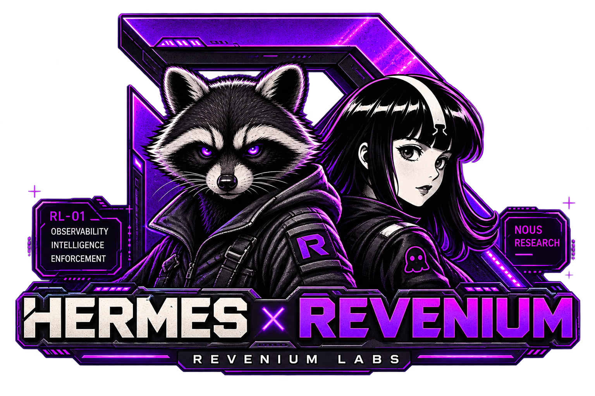
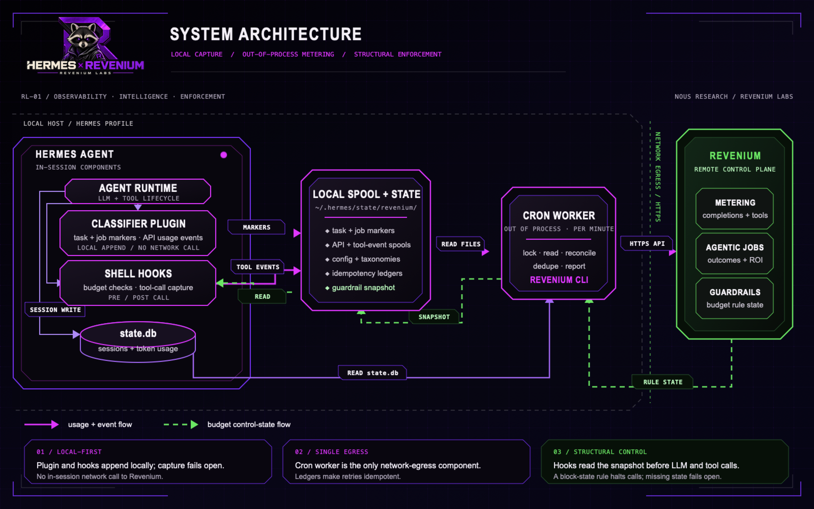
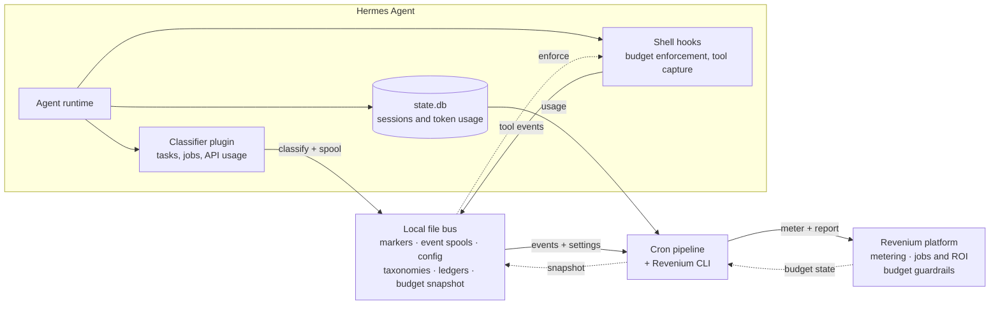

<div align="center">



# Hermes Revenium

**Langfuse traces your agent. Revenium governs it**: cost, value and ROI per job, with budget guardrails.

For [Hermes Agent](https://hermes-agent.nousresearch.com) on
[Revenium](https://www.revenium.ai). Value estimates are opt-in, not verified savings.


-f0a020?style=for-the-badge)

[](https://github.com/revenium/hermes-revenium/actions/workflows/tests.yml)
[](https://github.com/revenium/hermes-revenium/actions/workflows/secret-scan.yml)

[Quick start](#quick-start) ·
[Install](docs/installation.md) ·
[How it works](docs/how-it-works.md) ·
[Fleet](docs/fleet.md) ·
[Operations](docs/operations.md) ·
[Docs](docs/README.md) ·
[Discord](https://discord.gg/J2DbmjZ2nA)

</div>

## Quick start

### Optional full integration (standalone, not the catalog build)

With Hermes, the Revenium CLI, `git`, `sqlite3`, `python3` and your Revenium API key,
Team ID, Tenant ID and User ID ready, allow about five minutes for setup; approvals
and first metering can take longer. Review [What it sends where](#what-it-sends-where)
before running the bootstrap.

```bash
hermes skills install revenium/hermes-revenium/skills/revenium
bash "${HERMES_HOME:-$HOME/.hermes}/skills/revenium/references/bootstrap.sh"
```

The bootstrap fetches code from `main`, configures credentials, copies the classifier,
registers shell hooks, creates budget rules, installs a per-minute cron and offers a
restart. **It is not a pinned catalog install.** Use an isolated test profile first;
this is an explicit opt-in to the full integration and its background reporting.

Start a Hermes session, approve the hooks when prompted, run one small tool-using job,
and allow one cron tick (normally up to 60 seconds) after classification. Then verify:

```bash
bash "${HERMES_HOME:-$HOME/.hermes}/skills/revenium/scripts/plugin-status.sh"
bash "${HERMES_HOME:-$HOME/.hermes}/skills/revenium/scripts/hooks-status.sh"
python3 -c 'import json,os,pathlib; p=pathlib.Path(os.environ.get("HERMES_HOME",str(pathlib.Path.home()/".hermes")))/"state/revenium/guardrail-status.json"; d=json.loads(p.read_text()); assert d.get("lastChecked") and d.get("rules"), "No populated guardrail snapshot yet"; print("Guardrail snapshot:",d["lastChecked"],"halted:",d.get("halted"))'
```

Expect healthy classifier, registered **and firing** hooks, and a populated guardrail
snapshot. These checks verify local wiring, not receipt by Revenium: confirm the job's
cost and outcome in your Revenium account. Value/ROI requires the separate
[value configuration](docs/value-overview.md); it is not enabled by install alone.

For a pinned, plugin-only install with no bootstrap, cron or shell-hook writes, use the
[**catalog-safe path**](docs/catalog-install.md). Its capabilities and limitations are
listed there: opt-in classification and local API-usage capture only, **not Revenium
reporting or budget enforcement**. It reuses the actual classifier without the bootstrap.

> **Multiple profiles?** Set `HERMES_HOME` to the intended home; the full bootstrap
> also accepts `--profile <name>` (repeatable) or `--all-profiles`. Follow
> [fleet installation](docs/fleet.md). Never assume one profile's setup covers another.
> Full prerequisites and alternative paths: [installation guide](docs/installation.md).

**Demo GIF placeholder:** `docs/demo.gif` — not recorded yet.
[Shot list and recording checklist](docs/demo-script.md): run a job → inspect cost,
outcome and ROI → show a budget guardrail stopping further work.
<!-- Replace this placeholder after recording:  -->

**Pricing:** TODO(John): confirm which metering, jobs/outcomes, ROI and guardrail features
are included in Revenium's free plan and which require a paid plan. MIT covers this
repository's code, not hosted-service entitlements.

> ### 🧪 This is a Revenium Labs project
> **Revenium Labs** projects are field-developed, best-effort, beta-quality software shared
> in the open. They are
> **not** part of Revenium's officially supported products.
>
> - It may need adaptation for your environment.
> - It's provided as-is, without the versioned-release guarantees, SLAs or formal support
>   that back our core products.
> - Issues, feedback and PRs are welcome. [Join us on Discord](https://discord.gg/J2DbmjZ2nA).
>
> → **[What is Revenium Labs?](https://github.com/revenium/.github/blob/main/LABS.md)**

Hermes reports token totals per session. Revenium labels each metered completion with
the agent's task, tracks each task arc as a billable job and meters every tool call.
Shell hooks halt the agent when a budget rule blocks it. A successful job can also include an
estimated economic value, which Revenium combines with metered cost to display ROI.

## What you get

| | |
|---|---|
| **Semantic task types** | Every completion ships with `--task-type` and `--operation-type` from a controlled vocabulary. A plugin infers them from the session transcript instead of asking the agent to label itself. |
| **Agentic job tracking** | Discrete task arcs become Revenium jobs with immutable, once-only outcomes. Their transactions link back via `--agentic-job-id`. |
| **Tool-event metering** | Every Hermes tool call is metered through `revenium meter tool-event`, including its name, duration, success and error. |
| **Structural budget guardrails** | Hermes shell hooks read a local guardrail snapshot before every LLM call and every tool call, so enforcement does not depend on the agent choosing to comply. |
| **Job value estimation** *(experimental, opt-in, off by default)* | On a `SUCCESS` arc only, one bounded LLM call on your own provider estimates the job's economic value from two independently capped inputs. It is an unverified model estimate, not an observed outcome. Absent or malformed config fails closed, so an existing install meters byte-identically to before. Start with the [practical overview](docs/value-overview.md); [Job value and ROI](docs/value-and-roi.md) is the full reference. |
| **Auxiliary usage metering** *(on by default)* | Hermes' own compression, title-generation, approval, vision, web-extract and session-search LLM calls are metered as their own `--operation-type AUX` completions from a fixed `aux_*` vocabulary. This permanently increases reported spend against unchanged traffic; an off switch is available. **[Auxiliary usage migration](docs/migration-auxiliary-usage.md)** has the measured size and the caveats. |

> When value estimation is enabled, `--outcome-value`
> ships the **low** bound of the low/base/high band: the conservative figure, not the base.
> All three bounds and their provenance are included in `--metadata`, so the full range
> remains recoverable. The value on a Revenium dashboard is the floor of the range.
> [Job value and ROI](docs/value-and-roi.md) documents the whole path.

## Prerequisites

- [Hermes Agent](https://hermes-agent.nousresearch.com/docs/) installed and running
- [Revenium](https://app.revenium.ai/connections) API key, Team ID, Tenant ID and User ID
- [`revenium` CLI](https://github.com/revenium/revenium-cli): `brew install revenium/tap/revenium`
- `sqlite3` and `python3` on `PATH`

```bash
revenium config show
sqlite3 --version
python3 --version
```

## What it sends where

This describes the **optional full integration**; the catalog-only path has its own
[disclosure](docs/catalog-install.md). The cron invokes the Revenium CLI against your
configured Revenium API destination using the CLI's stored credentials.

| Destination | Data |
|---|---|
| **Revenium: completions** | Model/provider, input/output/cache/total token counts, timestamps and duration, stop reason and streaming flag; transaction, session/root trace and parent transaction identifiers; task/operation/trace types and names; agent, squad and role, environment/organization, job ID/name/type; configured or resolved subscriber identity (including email/name when enabled), skill and ticket attribution when supported. Auxiliary model usage is metered too. |
| **Revenium: tools and jobs** | Tool name/ID, timestamp, duration, success and bounded error message, trace/workflow linkage and configured dimensions; job ID/name/type and team, execution result/outcome type, source and bounded failure reason. |
| **Revenium: value and controls** | When enabled and reportable: value/currency and low/base/high range, supplied costs, attribution, role/hours/rate assumptions, confidence, evidence/mechanism/study, estimator/model/version/locality provenance; outcome timeline metrics and job-type economics where configured. Explicit setup sends budget-rule names, scope, limits and windows; polling reads rule/enforcement state. Operator correction/baseline commands also transmit their declared reasons, provenance and evidence references. |
| **Local files** | `job-assessments/` retains the append-only assessment/correction history; the sidecar file is not uploaded wholesale, but the selected fields above are reported. Evaluator prose (`basis`, `candidate_downstream_outcome`, `counterfactual_assumption`) stays local. Markers, event spools, taxonomies, ledgers and guardrail snapshots also remain local. Hermes retains its own transcript database. |
| **Your configured model provider** | Transcript excerpts go to the auxiliary classifier and, when enabled, the value evaluator. This can be a remote provider: “not sent to Revenium” does not mean “never leaves the host.” |

**Raw transcripts and raw model responses are not uploaded to Revenium by these reporters.**
A blanket “model free-text is never sent” claim would be false: generated job names,
failed-job reasons and inferred role labels can cross that boundary; tool error strings
can contain sensitive text too. Do not put secrets in those fields. Length limits are
not redaction. Evaluator narrative fields listed above are excluded from the wire.

The exact conditional payload contracts are documented in
[the wire reference](docs/value-and-roi.md#13-the-wire),
[event metering](docs/event-metering.md), [subscriber attribution](docs/subscriber-attribution.md)
and the executable [golden fixtures](tests/fixtures/compat/).

## Architecture

<div align="center">



[Open full-size diagram](assets/hermes-revenium-architecture.png) · [SVG source](assets/hermes-revenium-architecture.svg)

</div>

<details>
<summary>Mermaid source</summary>



</details>

The plugin and hooks do not call Revenium directly. They append local files; the cron
worker is the only component that sends metering and job data to the Revenium platform.

## What's actually installed

The package installs six pieces. Only one is the skill:

| Piece | What Hermes calls it | Where it lives | What it does |
|---|---|---|---|
| `revenium-classifier` | **plugin** (Python, `register(ctx)`, four lifecycle hooks) | `~/.hermes/plugins/` (per **profile** on a fleet) | Classification and the per-API-call event spool |
| `pre_llm_call`, `pre_tool_call`, `post_tool_call` | **shell hooks** registered in `config.yaml` | `~/.hermes/skills/revenium/scripts/` | Budget enforcement and tool-call capture |
| `cron.sh` and its six stages | **cron job**, out of process | `~/.hermes/skills/revenium/scripts/` | Everything that talks to the Revenium API |
| `SKILL.md` | **skill** (markdown loaded into the agent's context) | `~/.hermes/skills/revenium/` | A procedural halt-check backstop |
| `job-assessments/` | **state** (one append-only JSONL file per job) | `~/.hermes/state/revenium/` | The authoritative record of a job's assessment and its correction history. Kept 90 days (`REVENIUM_ASSESSMENT_RETENTION_DAYS`), against 30 for markers |
| `revenium-aux.ledger` | **state** (append-only, one line per auxiliary identity) | `~/.hermes/state/revenium/` | The idempotency record for the auxiliary pass; its own key domain, never pruned automatically (like the other three ledgers) |

Hermes loads plugins from `~/.hermes/plugins/` and skills from
`~/.hermes/skills/`. They use different roots and loaders, and `hermes skills install`
carries only the skill. The bootstrap installs the other pieces. On a multi-profile host,
a stale plugin copy is the most common silent failure because the skill tree is shared but
the plugin is not.

An assessment is never rewritten. If a value turns out to be wrong,
`scripts/correct-assessment.sh` appends a correction locally as a new line in the job's
sidecar and remotely through `revenium jobs outcome-update`, which adds a revision rather
than replacing one. The original stays byte-identical and readable. It is operator-only and
deliberately unreachable from cron, and `--dry-run` shows what it would do without writing
anything, locally or remotely.

## Documentation

| Guide | What it covers |
|---|---|
| [Installation](docs/installation.md) | Four install paths, credentials, guardrail rules, cron, hooks, plugin and how to verify the result |
| [How it works](docs/how-it-works.md) | The classification pipeline, all three metering paths, agentic jobs, tool events and guardrail enforcement |
| [Configuration](docs/configuration.md) | `config.json` fields, credential storage and the two event-metering switches |
| [Multi-profile / fleet](docs/fleet.md) | Per-profile installs and common fleet failures |
| [Upgrading](docs/upgrading.md) | Four upgrade paths and what must be re-run after each |
| [Operations](docs/operations.md) | Manual commands, diagnostics, uninstall and the test suite |
| [Event metering](docs/event-metering.md) | The v1.5 event path in depth: mechanism, cutover and rollback |
| [Plugin interface](docs/plugin-interface.md) | The Hermes plugin surfaces the classifier registers against and what each one can and cannot see |
| [Evidence classes](docs/evidence-class-precedence.md) | Which boundary decides a record's `evidence_class`, the fixed precedence order and what a declaration may and may not claim · [Claim distinctions](docs/claim-distinctions-and-evidence-boundaries.md) |
| [Migrations](docs/migration-guardrails.md) | [Guardrails](docs/migration-guardrails.md) · [AGENT dimension](docs/migration-agent-dimension.md) · [Auxiliary usage](docs/migration-auxiliary-usage.md) |

Reference material that ships inside the skill bundle lives at
[`skills/revenium/references/`](skills/revenium/references/):
[setup](skills/revenium/references/setup.md),
[troubleshooting](skills/revenium/references/troubleshooting.md),
[task taxonomy](skills/revenium/references/task-taxonomy.md) and the
[config schema](skills/revenium/references/config-schema.md).


## Notes

- The skill is packaged at `skills/revenium/` so the default `hermes skills tap add owner/repo`
  discovery path resolves it without extra configuration.
- Mutable runtime state lives under `~/.hermes/state/revenium/`; skill content lives under
  `~/.hermes/skills/revenium/`. Don't mix the two.
- This repo is Hermes-only by design, with no legacy runtime assumptions from the
  skill it was forked from.

## Contributing

Issues and PRs are welcome. See [CONTRIBUTING.md](CONTRIBUTING.md) for how the repo is
laid out, the invariants the test suite enforces and what to run before opening a PR.

## Changelog

Release history is in [CHANGELOG.md](CHANGELOG.md).

## License

[MIT](LICENSE), the same license as [Hermes Agent](https://github.com/NousResearch/hermes-agent)
itself and the one `skills/revenium/SKILL.md` declares in its frontmatter.

## Support

Questions, bugs or feature requests? Join us on [Discord](http://discord.gg/J2DbmjZ2nA).
